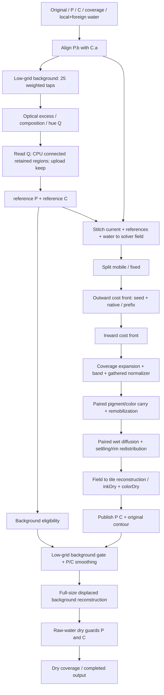

# Native Mini: карта реального расчёта

Это карта текущих исходников 805, не замеры и не схема альтернатив Curtis/u32. Каноническая сборка/параметры/вход/бумага должны быть связаны SHA в операторском отчёте. Число операций зависит от flags, контактов, цвета и вставляемых continuation; фиксированное «89» не является контрактом. Два маленьких water jobs и ~267мс подготовки привязываются к отдельным фактическим invocation ID в отчёте host, не приписываются одному большому полю по догадке.

## Точные границы / данные

Пути ниже относительно `apps/web/src/engine/src/`.

| Узел | Код | Вход → выход и смысл снимка |
|---|---|---|
| Raw acquisition / upload / 2 tiny jobs | Host/controller, до `resetFromScratch` | Исходные7planes+paper; это отдельная подготовка. В этой instrumentation нет выдуманного времени267мс: host измеряет actual invocations. |
| Clone + alignment | `watercolor/puddle/PuddleTarget.ts:102`, shader:56, align:125–131 | Клонируются original,coverage,P,C. `P.b=min(C.a,P.a)`, прочие каналы P сохранены. Tap `align.rawP`: фактические P/C после copy. Initial water local или foreign; оба складываются fieldOp mode1. |
| Low background | `ContrastPhase.ts:10`, prepare:23 | C→low background, 5×5 taps со stride24 worldpx и треугольными весами; encoded `c/(1+c)`. Это оценка локального фона, не готовая картина. Tap `contrast.background`. |
| Q | `ContrastPhase.ts:11`, run:24–27 | C/P/water/background→selection (optical2). Положительный optical excess, масса/состав/разница hue, wet gate. Tap `contrast.selection`. |
| Retained components | `ContrastPhase.ts:27–30` | selection.readPixels→CPU retainedComponents/minarea→regionKeep.writePixels. Tap `contrast.retainedComponents`. Это CPU barrier+upload, нельзя считать GPU time. Возвращаемый `selection` в объекте API фактически regionKeep. |
| Reference split | `ContrastPhase.ts:30` | P/C + keep→referenceP/referenceC (`entry.inkSettled/colorSettled`). Убирается выбранная мобильная часть, остальное остаётся опорным фоном. Taps `contrast.referenceP/C`. Selection напрямую downstream не читается. |
| Background eligibility | `BackgroundMix.ts:14,31` | initialP/referenceP/coverage→eligible: исключает сильные пики и сухую область. `background.eligibility`. |
| Prepare / capture | `raster/WatercolorSettlePlan.ts:393–492` | Первый op uploads contacts/foreign; clears field; stitches P→a,referenceP→b,C→ca,referenceC→cb,coverage и solvent. S/origin реальные из события. `stitch.complete`. P/C baseline snapshots a0/ca0 сохраняются для реконструкции. |
| Mobile/fixed | `WatercolorSettlePlan.ts:765–785` | mode0 mobile=(laid−settled)*share→c; mode1 fixed=laid−mobile→b. C в lockstep; field aliases a/b/c не имеют вечной роли. Tap `fieldOp` mode0/1. |
| Front seed | `WatercolorSettlePlan.ts:584` | mobile+coverage→pressure mode10. R encoded outward cost, auxiliary channels несут shader-specific height/flags. Это НЕ pigment. |
| Front propagation | `WatercolorSettlePlan.ts:570–594`, `WatercolorPasses.ts:202–309` | pressure/src→dst pingpong, бумага/coverage/foreign water; после последнего возможен mode1 homecopy. `front.complete` после всего вызова; native stride1 не использует prefix. Params max/climb/floor/stride/S записываются. |
| Prefix cache | `WatercolorFrontPaths.ts:40–68,78–143` | 4 directional-pair packed edge maps: base unit costs, then length1/2/4 combines, затем jump по8directions. RG и BA — packed 16bit costs; обычное RGB-preview вводит в заблуждение. `front.prefixBuild`/`front.prefixJump` — каждый фактический producer draw. Cache зависит от field/world/cost/stride/foreign; stride1 invalidates cached. |
| Inward | `WatercolorSettlePlan.ts:603–613` | mode12 pressure→mask seed; 2flat passes, затем gentler relief. Tap mode12 и front.complete с соответствующим max/climb. Внутренний край/пальцы, не новая вода. |
| Coverage + band | `WatercolorSettlePlan.ts:614–623` | mode11 coverage/pressure→tmp→coverage; mode6 pressure+inwardmask+coverage→band. Затем mode5 binomial gathers stride1,2,4… в mask (normalizer). `fieldOp` mode11/6/5. R/G/B/A band показывать раздельно с shaderformula, не утверждать «wetness» по внешнему цвету. |
| Carry | `WatercolorSettlePlan.ts:810–855` | dyadic carry: mode16 C использует pre-update pigment; затем mode15 P, shared pressure/fixed/water/path. За один op могут быть2+draws и presentation. Taps mode16/15 снимают действительную запись. |
| Remobilization/rim/diffusion | `WatercolorSettlePlan.ts:628–642,869–1019` | fixed/mobile redistribution, gathered band, mode7/9 lift, mode8/14 rim redistribution. Diffusion follows WET_DIFFUSE_SCHEDULE с P/C в lockstep, gate/density/solvent. `diffuse` после каждого pass плюс все fieldOp. Не обычный единый Gaussian blur. |
| Final land | `WatercolorSettlePlan.ts:1210–1335` | fromField/fromColorField reconstruct against captured baseline, entry settled/current/dry planes; finish land() до dispose. `land.complete` details contains entries: оператор может выбрать entry.inkDry/colorDry до освобождения. Пустой outputs намеренно: нельзя угадывать текущие alias. |
| Publish | `PuddleTarget.ts:94–99,187` | final inkDry??inkLoad/colorDry??inkColor→out.P/C; contour→out.coverage. Первый publish в reset до solver — initial, не конечный. Event revision/epoch отличают их. |
| Background smoothing | `BackgroundMix.ts:32–40` | eligible→gate; current P/C→low p0/c0 fourhalftexelavg; four paired smooth steps radii2/4/8/4→pa/pb/ca/cb. Тaps `background.copy/smooth`, source texture identities в detail. Это8smoothdraws в4ops. |
| Background reconstruction | `BackgroundMix.ts:20–27,41–42` | source/full P or C + finalLow + eligibility/coverage + spatialnoise→full, copyToP/C. Strength/distortion captured once. `lowBefore` declared but actual shader не использует; не рисовать фиктивный dependency. `background.reconstruct` снимает full до копии. |
| Dry guards | `PuddleTarget.ts:55,189` | initial rawP/rawC + result + initialWater→temp→dst; wet=smoothstep(0,.03,4water.a). Tap `dryGuard`. Guard сохраняет сухой исходник, это отдельные реальные2draws+copies. |
| Dry output | `PuddleTarget.ts:207–226` | target.dry() обновляет coverage с последующим copy. Tap `dry.coverage`; RGB compositor/common encoding идут отдельно, не часть native material. |

## Как получить реальные изображения

`source-taps.cjs` — failclosed transformer пяти модулей только QA bundle. Не редактирует engine, shader arithmetic, drawcalls и op functions/tags. `capture.ts` временно ставит один global callback, снимает ТОЛЬКО выбранные buffers сразу в их фактической lifetime; возвращает GLbottomup RGBA8 и dimensions. Чтение сохраняет FBO, не публикует текстуру и не держит pool lease. Ограничение128MiB на replay; для большого поля выбирать1–2stage за проход. `land.complete` entries надо разобрать синхронно, не сохранять ссылки до следующего шага. State-copy/PNG/hash/render вне timing. Для pressure/band показывать raw канал/packed decode с легендой; P/C через тот же common optical renderer и fixedsourceScale. Нельзя генерировать промежуточную иллюстрацию по формулам.

## Время без EXT_disjoint_timer_query

Samsung WebGL1 extension отсутствует: нет корректного GPUelapsed каждого pass. Отдельно: (1) matched wholebaseline без taps/reads; (2) event trace без snapshots (host submissionwall, не GPU); (3) выбранные semantic-prefix fresh replays с full output dependency read и остановкой после tap, cumulative prefix wall; (4) untimed snapshots. Разности/сумма forced-read prefixes НЕ являются точным временем блоков: меняются stalls/overlap/cache. Query-capable устройство может дать begin/end по последовательным semantic ranges без overlapping queries, polling вне измеряемого GPU, но это другая платформа/эксперимент. Timing protocol согласуется root/operator; здесь не измерений.

Визуальные before/after: raw→align, background/Q/keep/reference, stitch→mobile, outward/inward/band/mask, carry/diffusion→land, backgroundbefore/after→reconstruct, dryguard→drycoverage. Реальные snapshots/числа ещё должен произвести оператор; этот документ не подменяет их схемой.
